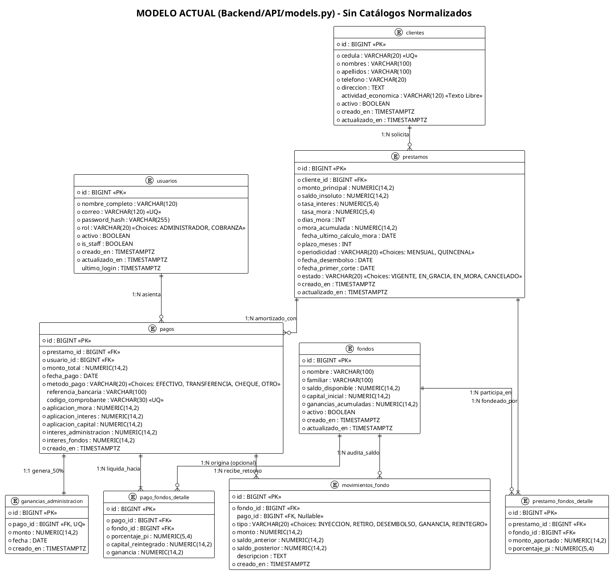
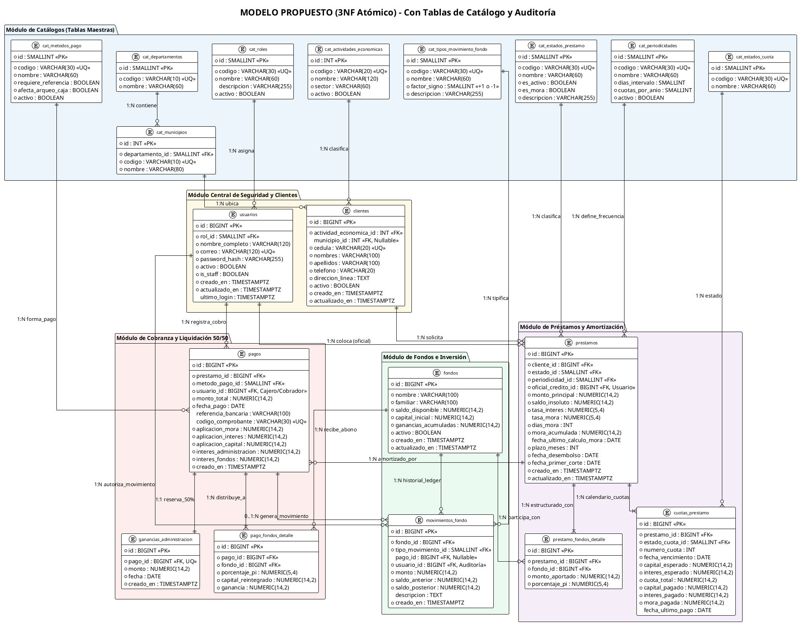

# Análisis Exhaustivo de Normalización de Base de Datos - CAVI
**Sistema de Microcréditos y Gestión Multifondo Familiar**  
**Fecha:** Octubre 2026 | **Versión:** 2.0 (Arquitectura Relacional Normalizada)

---

## 1. Diagnóstico y Hallazgos del Esquema Actual

Al inspeccionar [`Backend/API/models.py`](file:///c:/Users/enyelpapuh/Desktop/Proyectos/CAVI/Backend/API/models.py) y las interfaces del frontend (`frontend/src/pages/` y `frontend/src/types/index.ts`), se identifican las siguientes áreas de oportunidad y deficiencias estructurales:

### 1.1. Catálogos "Quemados" (Hardcoded) en Código y Arrays
Actualmente, múltiples atributos críticos para la operación financiera están definidos como clases `models.TextChoices` en Python y duplicados manualmente como arreglos constantes en TypeScript:

1. **Roles de Usuario (`RolUsuario` / `ROLES`):**
   - *Actual:* `'ADMINISTRADOR'`, `'COBRANZA'` en `CharField(20)` y en `ROLES = [{ value, label }]`.
   - *Problema:* No permite crear nuevos roles (`SUPERVISOR`, `AUDITOR_UAF`, `CAJERO`) sin desplegar código nuevo. No hay tabla para permisos modulares granulares (RBAC).
2. **Estados de Préstamo (`Prestamo.Estado` / `FILTROS`):**
   - *Actual:* `'VIGENTE'`, `'EN_GRACIA'`, `'EN_MORA'`, `'CANCELADO'`. En el frontend se calcula además `'AL_DIA'`.
   - *Problema:* Dependencia de cadenas de texto en bases de datos. Si un script o consulta externa inserta `'MORA'` o `'VIG'` se pierde la integridad referencial.
3. **Periodicidad de Cobro (`Prestamo.Periodicidad` / `PERIODICIDADES`):**
   - *Actual:* `'MENSUAL'`, `'QUINCENAL'` quemados en el modelo y en `PrestamoFormPage.tsx`.
   - *Problema:* No parametriza atributos intrínsecos como la cantidad de días del ciclo o el factor de conversión de tasa (30 vs 15 vs 7 días).
4. **Métodos de Pago (`Pago.MetodoPago` / `METODOS`):**
   - *Actual:* `'EFECTIVO'`, `'TRANSFERENCIA'`, `'CHEQUE'`, `'OTRO'`.
   - *Problema:* No parametriza reglas operativas como si el método exige o no conciliación bancaria (`referencia_bancaria`), ni si afecta el arqueo de efectivo físico de caja.
5. **Tipos de Movimiento de Fondo (`TipoMovimiento`):**
   - *Actual:* `'INYECCION'`, `'RETIRO'`, `'DESEMBOLSO'`, `'GANANCIA'`, `'REINTEGRO'`.
   - *Problema:* Carece del signo aritmético formal (`factor_signo`: `+1` o `-1`) a nivel de base de datos; la lógica aritmética queda dispersa en servicios de backend.
6. **Actividad Económica del Cliente (`actividad_economica`):**
   - *Actual:* `CharField(120, blank=True, null=True)` de texto libre en la tabla `clientes`.
   - *Problema:* Errores tipográficos (`"Pulpería"`, `"pulperia"`, `"Comercio"`) impiden generar reportes consolidados de riesgo crediticio por sector económico o cumplimiento ante normativas antilavado (UAF - Ley 977).

### 1.2. Violaciones de Normalización (1FN, 2FN, 3FN) y Ausencia de Auditoría
- **Violación 1FN (Atomicidad Geográfica):** `direccion` es un campo de texto largo sin normalización de División Político-Administrativa (Departamento / Municipio de Nicaragua).
- **Violación 3FN (Dependencia Transitiva en Estados y Catálogos):** Las descripciones legibles y reglas de validación residen en código de aplicación en vez de tablas maestras con llaves foráneas (`FK`).
- **Vacío en Auditoría de Fondos:** La tabla `movimientos_fondo` registra entradas y salidas de dinero, pero **no registra el `usuario_id`** que realizó la inyección o el retiro. Solo los desembolsos vinculados a `Pago` tienen trazabilidad de usuario.
- **Ausencia de Tabla de Calendario/Cuotas (`cuotas_prestamo`):** Actualmente las cuotas son virtuales y calculadas en memoria por el backend. En sistemas bancarios o de microfinanzas formales, una relación 1 a N (`prestamos` → `cuotas_prestamo`) garantiza la conciliación exacta de capital e intereses devengados cuota por cuota.

---

## 2. Diagrama PlantUML: Modelo Actual (Estado Ahorita)

Este diagrama refleja exactamente el modelo definido en [`Backend/API/models.py`](file:///c:/Users/enyelpapuh/Desktop/Proyectos/CAVI/Backend/API/models.py).



---

## 3. Diagrama PlantUML: Nueva Propuesta Normalizada (3NF Atómica)

La nueva propuesta normaliza todas las elecciones a catálogos relacionales, añade la entidad de cuotas/calendario de pago, integra auditoría formal de usuarios en cada movimiento de capital, y resuelve la atomicidad territorial y sectorial.



---

## 3. Matriz Comparativa: Esquema Actual vs. Propuesta Normalizada

| Componente | Estado Actual (`models.py`) | Nueva Propuesta Normalizada | Justificación Técnica y de Negocio |
| :--- | :--- | :--- | :--- |
| **Roles de Usuario** | `VARCHAR(20)` con `RolUsuario.choices` | `cat_roles` (`id`, `codigo`, `nombre`, `descripcion`) con FK `rol_id` | Permite escalar a nuevos perfiles (`SUPERVISOR`, `AUDITOR`) sin tocar código ni migraciones destructivas. |
| **Estados de Préstamo** | `VARCHAR(20)` con `Estado.choices` | `cat_estados_prestamo` (`id`, `codigo`, `nombre`, `es_mora`, etc.) | Evita inconsistencias de strings. Permite añadir banderas de control del semáforo de atraso directamente en la BD. |
| **Periodicidades** | `VARCHAR(20)` (`MENSUAL`, `QUINCENAL`) | `cat_periodicidades` (`id`, `codigo`, `dias_intervalo`, `cuotas_por_anio`) | Desacopla la lógica matemática: si se añade `SEMANAL` (7 días), el motor financiero toma los días directamente de la tabla. |
| **Métodos de Pago** | `VARCHAR(20)` (`EFECTIVO`, etc.) | `cat_metodos_pago` (`id`, `codigo`, `requiere_referencia`, `afecta_arqueo_caja`) | Facilita el Arqueo de Caja y conciliaciones bancarias automatizadas según la naturaleza del método de cobro. |
| **Movimientos de Fondo** | `VARCHAR(20)` (`TipoMovimiento`) | `cat_tipos_movimiento_fondo` (`id`, `codigo`, `factor_signo`) | El campo `factor_signo` (`+1` o `-1`) permite verificar por trigger o consulta SQL que el `saldo_posterior` sea matemáticamente exacto. |
| **Auditoría de Fondos** | No existe `usuario_id` en `movimientos_fondo` | FK `usuario_id` en `movimientos_fondo` | Requisito fundamental de control interno y auditoría: saber qué usuario inyectó o retiró capital de una bolsa. |
| **Actividad Económica** | `VARCHAR(120)` texto libre | `cat_actividades_economicas` (`id`, `codigo`, `nombre`, `sector`) | Integridad de datos para reportes UAF (Ley 977) y análisis de concentración de riesgo crediticio por rubro. |
| **Dirección Geográfica** | `TEXT` texto libre | `cat_departamentos` y `cat_municipios` + `direccion_linea` | 1FN: Atomicidad territorial. Permite agrupar carteras y ruteo de cobro por municipio/barrio en Nicaragua. |
| **Calendario de Amortización** | Virtual en memoria (Frontend / Services) | Tabla `cuotas_prestamo` | Control atómico de cuotas vencidas, intereses devengados y mora por cuota exacta (Ley 176 / Art. 3180). |

---

## 4. Script DDL para PostgreSQL (DDL + Constraints + Seeds)

El siguiente script está listo para ser ejecutado en PostgreSQL (pgAdmin, DBeaver, psql, dbdiagram.io) para crear el esquema relacional completo, las claves foráneas, las restricciones de validación y la carga inicial (seeds) de todos los catálogos.

```sql
-- ============================================================================
-- SISTEMA CAVI - ESQUEMA RELACIONAL NORMALIZADO (PostgreSQL DDL)
-- Versión: 2.0 (Atomicidad 3NF, Catálogos Normalizados y Auditoría)
-- ============================================================================

-- 0. EXTENSIONES Y LIMPIEZA PREVIA (Opcional)
CREATE EXTENSION IF NOT EXISTS "uuid-ossp";

-- ============================================================================
-- 1. TABLAS DE CATÁLOGO (MAESTROS)
-- ============================================================================

-- 1.1 Catálogo de Roles de Usuario
CREATE TABLE cat_roles (
    id SMALLINT GENERATED ALWAYS AS IDENTITY PRIMARY KEY,
    codigo VARCHAR(30) NOT NULL UNIQUE,
    nombre VARCHAR(60) NOT NULL,
    descripcion VARCHAR(255),
    activo BOOLEAN NOT NULL DEFAULT TRUE,
    creado_en TIMESTAMPTZ NOT NULL DEFAULT CURRENT_TIMESTAMP
);
COMMENT ON TABLE cat_roles IS 'Catálogo maestro de roles del sistema (RBAC)';

-- 1.2 Catálogo de Estados del Préstamo
CREATE TABLE cat_estados_prestamo (
    id SMALLINT GENERATED ALWAYS AS IDENTITY PRIMARY KEY,
    codigo VARCHAR(30) NOT NULL UNIQUE,
    nombre VARCHAR(60) NOT NULL,
    es_activo BOOLEAN NOT NULL DEFAULT TRUE,
    es_mora BOOLEAN NOT NULL DEFAULT FALSE,
    descripcion VARCHAR(255),
    creado_en TIMESTAMPTZ NOT NULL DEFAULT CURRENT_TIMESTAMP
);
COMMENT ON TABLE cat_estados_prestamo IS 'Catálogo de estados operativos y regulatorios del crédito';

-- 1.3 Catálogo de Periodicidades de Cobro
CREATE TABLE cat_periodicidades (
    id SMALLINT GENERATED ALWAYS AS IDENTITY PRIMARY KEY,
    codigo VARCHAR(30) NOT NULL UNIQUE,
    nombre VARCHAR(60) NOT NULL,
    dias_intervalo SMALLINT NOT NULL CHECK (dias_intervalo > 0),
    cuotas_por_anio SMALLINT NOT NULL CHECK (cuotas_por_anio > 0),
    activo BOOLEAN NOT NULL DEFAULT TRUE,
    creado_en TIMESTAMPTZ NOT NULL DEFAULT CURRENT_TIMESTAMP
);
COMMENT ON TABLE cat_periodicidades IS 'Periodicidades de pago configuradas con factores matemáticos';

-- 1.4 Catálogo de Métodos de Pago
CREATE TABLE cat_metodos_pago (
    id SMALLINT GENERATED ALWAYS AS IDENTITY PRIMARY KEY,
    codigo VARCHAR(30) NOT NULL UNIQUE,
    nombre VARCHAR(60) NOT NULL,
    requiere_referencia BOOLEAN NOT NULL DEFAULT FALSE,
    afecta_arqueo_caja BOOLEAN NOT NULL DEFAULT FALSE,
    activo BOOLEAN NOT NULL DEFAULT TRUE,
    creado_en TIMESTAMPTZ NOT NULL DEFAULT CURRENT_TIMESTAMP
);
COMMENT ON TABLE cat_metodos_pago IS 'Medios e instrumentos financieros de pago aceptados en caja';

-- 1.5 Catálogo de Tipos de Movimiento de Fondo
CREATE TABLE cat_tipos_movimiento_fondo (
    id SMALLINT GENERATED ALWAYS AS IDENTITY PRIMARY KEY,
    codigo VARCHAR(30) NOT NULL UNIQUE,
    nombre VARCHAR(60) NOT NULL,
    factor_signo SMALLINT NOT NULL CHECK (factor_signo IN (1, -1)),
    descripcion VARCHAR(255),
    creado_en TIMESTAMPTZ NOT NULL DEFAULT CURRENT_TIMESTAMP
);
COMMENT ON TABLE cat_tipos_movimiento_fondo IS 'Tipos de transacción sobre bolsas de inversión con signo contable';

-- 1.6 Catálogo de Estados de Cuota de Amortización
CREATE TABLE cat_estados_cuota (
    id SMALLINT GENERATED ALWAYS AS IDENTITY PRIMARY KEY,
    codigo VARCHAR(30) NOT NULL UNIQUE,
    nombre VARCHAR(60) NOT NULL,
    descripcion VARCHAR(255)
);
COMMENT ON TABLE cat_estados_cuota IS 'Estados de liquidación de cada cuota individual';

-- 1.7 Catálogo de Actividades Económicas (UAF / Riesgo)
CREATE TABLE cat_actividades_economicas (
    id INT GENERATED ALWAYS AS IDENTITY PRIMARY KEY,
    codigo VARCHAR(20) NOT NULL UNIQUE,
    nombre VARCHAR(120) NOT NULL,
    sector VARCHAR(60) NOT NULL,
    activo BOOLEAN NOT NULL DEFAULT TRUE,
    creado_en TIMESTAMPTZ NOT NULL DEFAULT CURRENT_TIMESTAMP
);
COMMENT ON TABLE cat_actividades_economicas IS 'Padrón de actividades comerciales y oficios de los prestatarios';

-- 1.8 División Político-Administrativa (Nicaragua)
CREATE TABLE cat_departamentos (
    id SMALLINT GENERATED ALWAYS AS IDENTITY PRIMARY KEY,
    codigo VARCHAR(10) NOT NULL UNIQUE,
    nombre VARCHAR(60) NOT NULL
);

CREATE TABLE cat_municipios (
    id INT GENERATED ALWAYS AS IDENTITY PRIMARY KEY,
    departamento_id SMALLINT NOT NULL REFERENCES cat_departamentos(id) ON DELETE RESTRICT,
    codigo VARCHAR(10) NOT NULL UNIQUE,
    nombre VARCHAR(80) NOT NULL
);
CREATE INDEX idx_municipios_depto ON cat_municipios(departamento_id);

-- ============================================================================
-- 2. TABLAS OPERATIVAS PRINCIPALES
-- ============================================================================

-- 2.1 Usuarios del Sistema
CREATE TABLE usuarios (
    id BIGINT GENERATED ALWAYS AS IDENTITY PRIMARY KEY,
    rol_id SMALLINT NOT NULL REFERENCES cat_roles(id) ON DELETE RESTRICT,
    nombre_completo VARCHAR(120) NOT NULL,
    correo VARCHAR(120) NOT NULL UNIQUE,
    password_hash VARCHAR(255) NOT NULL,
    activo BOOLEAN NOT NULL DEFAULT TRUE,
    is_staff BOOLEAN NOT NULL DEFAULT FALSE,
    creado_en TIMESTAMPTZ NOT NULL DEFAULT CURRENT_TIMESTAMP,
    actualizado_en TIMESTAMPTZ NOT NULL DEFAULT CURRENT_TIMESTAMP,
    ultimo_login TIMESTAMPTZ
);
CREATE INDEX idx_usuarios_correo ON usuarios(correo);
CREATE INDEX idx_usuarios_rol ON usuarios(rol_id);

-- 2.2 Clientes Prestatarios
CREATE TABLE clientes (
    id BIGINT GENERATED ALWAYS AS IDENTITY PRIMARY KEY,
    actividad_economica_id INT NOT NULL REFERENCES cat_actividades_economicas(id) ON DELETE RESTRICT,
    municipio_id INT REFERENCES cat_municipios(id) ON DELETE RESTRICT,
    cedula VARCHAR(20) NOT NULL UNIQUE,
    nombres VARCHAR(100) NOT NULL,
    apellidos VARCHAR(100) NOT NULL,
    telefono VARCHAR(20) NOT NULL,
    direccion_linea TEXT NOT NULL,
    activo BOOLEAN NOT NULL DEFAULT TRUE,
    creado_en TIMESTAMPTZ NOT NULL DEFAULT CURRENT_TIMESTAMP,
    actualizado_en TIMESTAMPTZ NOT NULL DEFAULT CURRENT_TIMESTAMP
);
CREATE INDEX idx_clientes_cedula ON clientes(cedula);
CREATE INDEX idx_clientes_nombre ON clientes(nombres, apellidos);
CREATE INDEX idx_clientes_actividad ON clientes(actividad_economica_id);

-- 2.3 Bolsas de Fondos Familiares
CREATE TABLE fondos (
    id BIGINT GENERATED ALWAYS AS IDENTITY PRIMARY KEY,
    nombre VARCHAR(100) NOT NULL,
    familiar VARCHAR(100) NOT NULL,
    saldo_disponible NUMERIC(14,2) NOT NULL DEFAULT 0.00 CHECK (saldo_disponible >= 0),
    capital_inicial NUMERIC(14,2) NOT NULL CHECK (capital_inicial >= 0),
    ganancias_acumuladas NUMERIC(14,2) NOT NULL DEFAULT 0.00 CHECK (ganancias_acumuladas >= 0),
    activo BOOLEAN NOT NULL DEFAULT TRUE,
    creado_en TIMESTAMPTZ NOT NULL DEFAULT CURRENT_TIMESTAMP,
    actualizado_en TIMESTAMPTZ NOT NULL DEFAULT CURRENT_TIMESTAMP
);
CREATE INDEX idx_fondos_activo ON fondos(activo);

-- 2.4 Créditos Otorgados (Préstamos)
CREATE TABLE prestamos (
    id BIGINT GENERATED ALWAYS AS IDENTITY PRIMARY KEY,
    cliente_id BIGINT NOT NULL REFERENCES clientes(id) ON DELETE RESTRICT,
    estado_id SMALLINT NOT NULL REFERENCES cat_estados_prestamo(id) ON DELETE RESTRICT,
    periodicidad_id SMALLINT NOT NULL REFERENCES cat_periodicidades(id) ON DELETE RESTRICT,
    oficial_credito_id BIGINT REFERENCES usuarios(id) ON DELETE RESTRICT,
    monto_principal NUMERIC(14,2) NOT NULL CHECK (monto_principal > 0),
    saldo_insoluto NUMERIC(14,2) NOT NULL DEFAULT 0.00 CHECK (saldo_insoluto >= 0),
    tasa_interes NUMERIC(5,4) NOT NULL CHECK (tasa_interes >= 0),
    tasa_mora NUMERIC(5,4) CHECK (tasa_mora IS NULL OR tasa_mora >= 0),
    dias_mora INT NOT NULL DEFAULT 0 CHECK (dias_mora >= 0),
    mora_acumulada NUMERIC(14,2) NOT NULL DEFAULT 0.00 CHECK (mora_acumulada >= 0),
    fecha_ultimo_calculo_mora DATE,
    plazo_meses INT NOT NULL CHECK (plazo_meses > 0),
    fecha_desembolso DATE NOT NULL,
    fecha_primer_corte DATE NOT NULL,
    creado_en TIMESTAMPTZ NOT NULL DEFAULT CURRENT_TIMESTAMP,
    actualizado_en TIMESTAMPTZ NOT NULL DEFAULT CURRENT_TIMESTAMP
);
CREATE INDEX idx_prestamos_cliente ON prestamos(cliente_id);
CREATE INDEX idx_prestamos_estado ON prestamos(estado_id);
CREATE INDEX idx_prestamos_fechas ON prestamos(fecha_desembolso, fecha_primer_corte);

-- 2.5 Detalle Multifondo del Préstamo (Partición Pi)
CREATE TABLE prestamo_fondos_detalle (
    id BIGINT GENERATED ALWAYS AS IDENTITY PRIMARY KEY,
    prestamo_id BIGINT NOT NULL REFERENCES prestamos(id) ON DELETE CASCADE,
    fondo_id BIGINT NOT NULL REFERENCES fondos(id) ON DELETE RESTRICT,
    monto_aportado NUMERIC(14,2) NOT NULL CHECK (monto_aportado > 0),
    porcentaje_pi NUMERIC(5,4) NOT NULL CHECK (porcentaje_pi > 0 AND porcentaje_pi <= 1.0000),
    CONSTRAINT uq_prestamo_fondo UNIQUE (prestamo_id, fondo_id)
);
CREATE INDEX idx_prestamo_fondos_prestamo ON prestamo_fondos_detalle(prestamo_id);
CREATE INDEX idx_prestamo_fondos_fondo ON prestamo_fondos_detalle(fondo_id);

-- 2.6 Cuotas Programadas / Calendario de Amortización
CREATE TABLE cuotas_prestamo (
    id BIGINT GENERATED ALWAYS AS IDENTITY PRIMARY KEY,
    prestamo_id BIGINT NOT NULL REFERENCES prestamos(id) ON DELETE CASCADE,
    estado_cuota_id SMALLINT NOT NULL REFERENCES cat_estados_cuota(id) ON DELETE RESTRICT,
    numero_cuota INT NOT NULL CHECK (numero_cuota > 0),
    fecha_vencimiento DATE NOT NULL,
    capital_esperado NUMERIC(14,2) NOT NULL CHECK (capital_esperado >= 0),
    interes_esperado NUMERIC(14,2) NOT NULL CHECK (interes_esperado >= 0),
    cuota_total NUMERIC(14,2) NOT NULL CHECK (cuota_total > 0),
    capital_pagado NUMERIC(14,2) NOT NULL DEFAULT 0.00,
    interes_pagado NUMERIC(14,2) NOT NULL DEFAULT 0.00,
    mora_pagada NUMERIC(14,2) NOT NULL DEFAULT 0.00,
    fecha_ultimo_pago DATE,
    CONSTRAINT uq_prestamo_num_cuota UNIQUE (prestamo_id, numero_cuota)
);
CREATE INDEX idx_cuotas_prestamo ON cuotas_prestamo(prestamo_id);
CREATE INDEX idx_cuotas_vencimiento ON cuotas_prestamo(fecha_vencimiento);
CREATE INDEX idx_cuotas_estado ON cuotas_prestamo(estado_cuota_id);

-- 2.7 Pagos y Abonos Asentados (Prelación Art. 3180)
CREATE TABLE pagos (
    id BIGINT GENERATED ALWAYS AS IDENTITY PRIMARY KEY,
    prestamo_id BIGINT NOT NULL REFERENCES prestamos(id) ON DELETE RESTRICT,
    metodo_pago_id SMALLINT NOT NULL REFERENCES cat_metodos_pago(id) ON DELETE RESTRICT,
    usuario_id BIGINT NOT NULL REFERENCES usuarios(id) ON DELETE RESTRICT,
    monto_total NUMERIC(14,2) NOT NULL CHECK (monto_total > 0),
    fecha_pago DATE NOT NULL,
    referencia_bancaria VARCHAR(100) NOT NULL DEFAULT '',
    codigo_comprobante VARCHAR(30) UNIQUE,
    aplicacion_mora NUMERIC(14,2) NOT NULL DEFAULT 0.00 CHECK (aplicacion_mora >= 0),
    aplicacion_interes NUMERIC(14,2) NOT NULL DEFAULT 0.00 CHECK (aplicacion_interes >= 0),
    aplicacion_capital NUMERIC(14,2) NOT NULL DEFAULT 0.00 CHECK (aplicacion_capital >= 0),
    interes_administracion NUMERIC(14,2) NOT NULL DEFAULT 0.00 CHECK (interes_administracion >= 0),
    interes_fondos NUMERIC(14,2) NOT NULL DEFAULT 0.00 CHECK (interes_fondos >= 0),
    creado_en TIMESTAMPTZ NOT NULL DEFAULT CURRENT_TIMESTAMP
);
CREATE INDEX idx_pagos_prestamo ON pagos(prestamo_id);
CREATE INDEX idx_pagos_usuario ON pagos(usuario_id);
CREATE INDEX idx_pagos_fecha ON pagos(fecha_pago);
CREATE INDEX idx_pagos_comprobante ON pagos(codigo_comprobante);

-- 2.8 Liquidación Atómica a Fondos por Pago (Trazabilidad UAF / Ley 977)
CREATE TABLE pago_fondos_detalle (
    id BIGINT GENERATED ALWAYS AS IDENTITY PRIMARY KEY,
    pago_id BIGINT NOT NULL REFERENCES pagos(id) ON DELETE RESTRICT,
    fondo_id BIGINT NOT NULL REFERENCES fondos(id) ON DELETE RESTRICT,
    porcentaje_pi NUMERIC(5,4) NOT NULL CHECK (porcentaje_pi > 0 AND porcentaje_pi <= 1.0000),
    capital_reintegrado NUMERIC(14,2) NOT NULL DEFAULT 0.00 CHECK (capital_reintegrado >= 0),
    ganancia NUMERIC(14,2) NOT NULL DEFAULT 0.00 CHECK (ganancia >= 0),
    CONSTRAINT uq_pago_fondo UNIQUE (pago_id, fondo_id)
);
CREATE INDEX idx_pago_fondos_pago ON pago_fondos_detalle(pago_id);
CREATE INDEX idx_pago_fondos_fondo ON pago_fondos_detalle(fondo_id);

-- 2.9 Ganancias de Administración (50% Retenido para CAVI)
CREATE TABLE ganancias_administracion (
    id BIGINT GENERATED ALWAYS AS IDENTITY PRIMARY KEY,
    pago_id BIGINT NOT NULL UNIQUE REFERENCES pagos(id) ON DELETE RESTRICT,
    monto NUMERIC(14,2) NOT NULL CHECK (monto >= 0),
    fecha DATE NOT NULL DEFAULT CURRENT_DATE,
    creado_en TIMESTAMPTZ NOT NULL DEFAULT CURRENT_TIMESTAMP
);
CREATE INDEX idx_ganancias_admin_fecha ON ganancias_administracion(fecha);

-- 2.10 Movimientos de Fondos (Ledger Financiero con Auditoría de Usuario)
CREATE TABLE movimientos_fondo (
    id BIGINT GENERATED ALWAYS AS IDENTITY PRIMARY KEY,
    fondo_id BIGINT NOT NULL REFERENCES fondos(id) ON DELETE RESTRICT,
    tipo_movimiento_id SMALLINT NOT NULL REFERENCES cat_tipos_movimiento_fondo(id) ON DELETE RESTRICT,
    pago_id BIGINT REFERENCES pagos(id) ON DELETE RESTRICT,
    usuario_id BIGINT NOT NULL REFERENCES usuarios(id) ON DELETE RESTRICT,
    monto NUMERIC(14,2) NOT NULL CHECK (monto > 0),
    saldo_anterior NUMERIC(14,2) NOT NULL CHECK (saldo_anterior >= 0),
    saldo_posterior NUMERIC(14,2) NOT NULL CHECK (saldo_posterior >= 0),
    descripcion TEXT NOT NULL DEFAULT '',
    creado_en TIMESTAMPTZ NOT NULL DEFAULT CURRENT_TIMESTAMP
);
CREATE INDEX idx_movimientos_fondo ON movimientos_fondo(fondo_id);
CREATE INDEX idx_movimientos_tipo ON movimientos_fondo(tipo_movimiento_id);
CREATE INDEX idx_movimientos_usuario ON movimientos_fondo(usuario_id);
CREATE INDEX idx_movimientos_creado ON movimientos_fondo(creado_en DESC);

-- ============================================================================
-- 3. DATOS SEMILLA (SEEDS) PARA POBLAR LOS CATÁLOGOS NORMALIZADOS
-- ============================================================================

-- 3.1 Roles de Usuario (Extraídos de RolUsuario y ROLES)
INSERT INTO cat_roles (codigo, nombre, descripcion, activo) VALUES
('ADMINISTRADOR', 'Administrador General', 'Acceso irrestricto, auditoría UAF y configuración de fondos', TRUE),
('COBRANZA', 'Oficial de Cobranza', 'Asentamiento de cobros, arqueo de caja y consulta de cartera', TRUE),
('SUPERVISOR', 'Supervisor de Operaciones', 'Aprobación de créditos y visualización ejecutiva', TRUE);

-- 3.2 Estados de Préstamo (Extraídos de Estado y FILTROS/ESTADOS)
INSERT INTO cat_estados_prestamo (codigo, nombre, es_activo, es_mora, descripcion) VALUES
('VIGENTE', 'Vigente / Al Día', TRUE, FALSE, 'Crédito al corriente sin cuotas atrasadas'),
('EN_GRACIA', 'En Período de Gracia', TRUE, FALSE, 'Cuota impaga dentro del margen legal de 4 días de gracia'),
('EN_MORA', 'En Mora Exigible', TRUE, TRUE, 'Atraso superior a 4 días; devenga interés moratorio (Art. 3180)'),
('CANCELADO', 'Cancelado / Finiquitado', FALSE, FALSE, 'Crédito totalmente saldado en capital, interés y mora');

-- 3.3 Periodicidades (Extraídas de Periodicidad y PERIODICIDADES)
INSERT INTO cat_periodicidades (codigo, nombre, dias_intervalo, cuotas_por_anio, activo) VALUES
('MENSUAL', 'Mensual', 30, 12, TRUE),
('QUINCENAL', 'Quincenal', 15, 24, TRUE),
('CATORCENAL', 'Catorcenal', 14, 26, TRUE),
('SEMANAL', 'Semanal', 7, 52, TRUE);

-- 3.4 Métodos de Pago (Extraídos de MetodoPago y METODOS)
INSERT INTO cat_metodos_pago (codigo, nombre, requiere_referencia, afecta_arqueo_caja, activo) VALUES
('EFECTIVO', 'Efectivo Físico', FALSE, TRUE, TRUE),
('TRANSFERENCIA', 'Transferencia Bancaria ACH', TRUE, FALSE, TRUE),
('CHEQUE', 'Cheque de Gerencia / Bancario', TRUE, FALSE, TRUE),
('OTRO', 'Otro Instrumento Financiero', FALSE, FALSE, TRUE);

-- 3.5 Tipos de Movimiento de Fondo (Extraídos de TipoMovimiento)
INSERT INTO cat_tipos_movimiento_fondo (codigo, nombre, factor_signo, descripcion) VALUES
('INYECCION', 'Inyección de Capital', 1, 'Aporte externo de capital al fondo'),
('RETIRO', 'Retiro de Capital', -1, 'Extracción de capital por el inversionista'),
('DESEMBOLSO', 'Desembolso de Préstamo', -1, 'Salida de capital para fondear un crédito'),
('GANANCIA', 'Acreditación de Ganancia', 1, 'Acreditación de intereses cobrados (50% fondos)'),
('REINTEGRO', 'Reintegro de Capital', 1, 'Retorno de capital amortizado por prestatarios');

-- 3.6 Estados de Cuota Individual
INSERT INTO cat_estados_cuota (codigo, nombre, descripcion) VALUES
('PENDIENTE', 'Pendiente', 'Cuota programada aún no vencida'),
('PAGADA', 'Pagada Totalmente', 'Cuota satisfecha en su totalidad'),
('PARCIAL', 'Abono Parcial', 'Cuota con abono parcial de capital o intereses'),
('VENCIDA', 'Vencida / En Mora', 'Cuota vencida impaga');

-- 3.7 Actividades Económicas Iniciales (Nicaragua / Microfinanzas)
INSERT INTO cat_actividades_economicas (codigo, nombre, sector, activo) VALUES
('ACT-001', 'Comercio Minorista / Pulpería', 'Comercio', TRUE),
('ACT-002', 'Venta de Ropa y Calzado', 'Comercio', TRUE),
('ACT-003', 'Comedor / Cafetería / Alimentos', 'Servicios', TRUE),
('ACT-004', 'Transporte / Taxi / Moto-Taxi', 'Transporte', TRUE),
('ACT-005', 'Taller Mecánico / Soldadura', 'Manufactura y Reparaciones', TRUE),
('ACT-006', 'Agricultura / Granos Básicos', 'Agropecuario', TRUE),
('ACT-007', 'Empleado Sector Privado / Público', 'Asalariado', TRUE),
('ACT-008', 'Servicios Profesionales / Técnicos', 'Servicios', TRUE);

-- 3.8 Departamentos de Nicaragua (Muestra representativa de cobertura)
INSERT INTO cat_departamentos (codigo, nombre) VALUES
('MN', 'Managua'),
('MS', 'Masaya'),
('GR', 'Granada'),
('CA', 'Carazo'),
('LE', 'León'),
('CH', 'Chinandega'),
('MT', 'Matagalpa');

-- 3.9 Municipios representativos de Managua y Masaya
INSERT INTO cat_municipios (departamento_id, codigo, nombre) VALUES
(1, 'MN-01', 'Managua (Distritos I - VII)'),
(1, 'MN-02', 'Ciudad Sandino'),
(1, 'MN-03', 'Tipitapa'),
(1, 'MN-04', 'Ticuantepe'),
(2, 'MS-01', 'Masaya'),
(2, 'MS-02', 'Nindirí'),
(2, 'MS-03', 'Masatepe');

-- ============================================================================
-- FIN DEL SCRIPT DDL
-- ============================================================================
```
