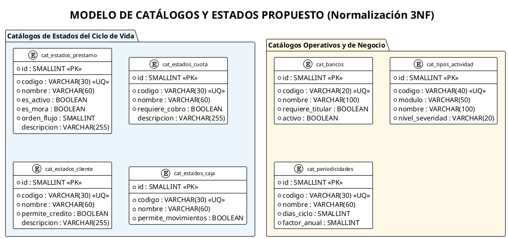
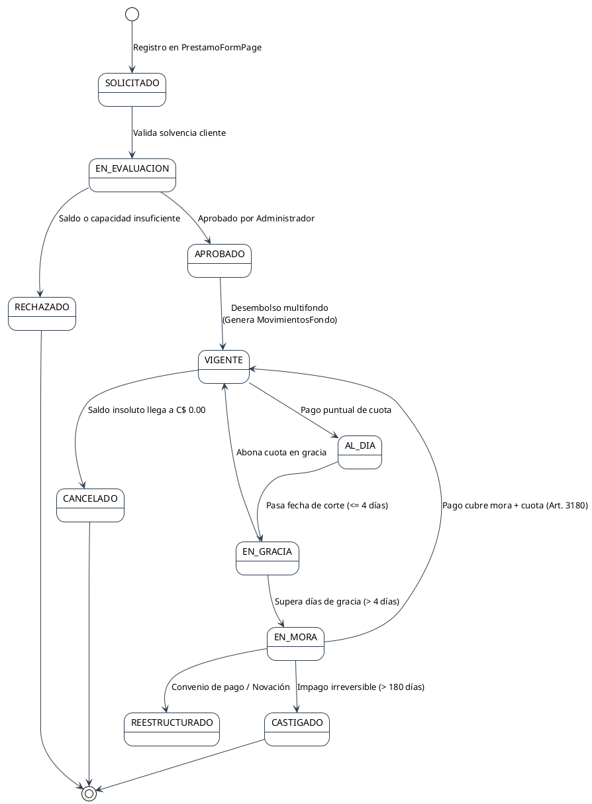
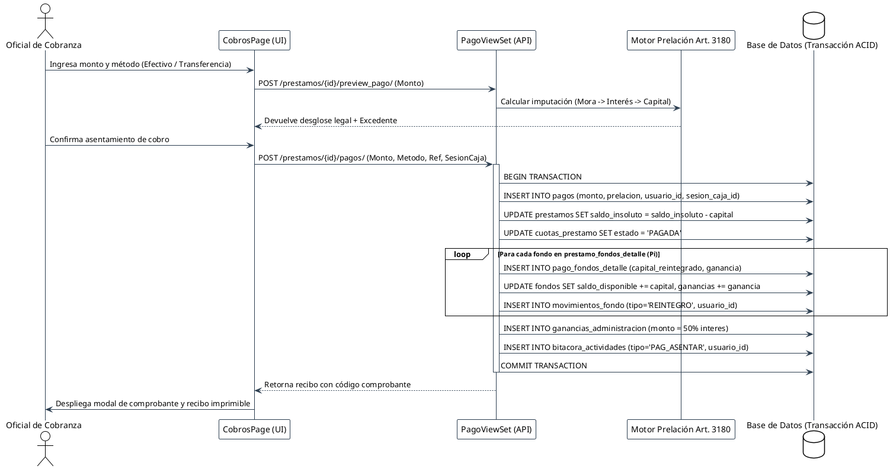

# Evaluación Integral de Requerimientos, Vistas Frontend y Catálogos de Base de Datos
**Sistema CAVI: Microcréditos y Gestión Multifondo Familiar**  
**Fecha:** Octubre 2026 | **Documento Técnico de Diagnóstico y Expansión Funcional**

---

## 1. Resumen Ejecutivo y Alcance de la Auditoría

El presente documento establece un diagnóstico exhaustivo de la plataforma **CAVI**, analizando la coherencia entre:
1. **Los Requerimientos del Sistema (SRS / Documento de Avance)**: Necesidades normativas y de gestión de cartera en microfinanzas nicaragüenses (Ley N° 176, Art. 3180 del Código Civil y Ley N° 977 de prevención UAF).
2. **Las Vistas del Frontend (`frontend/src/pages/`)**: Identificando qué pantallas son 100% funcionales, cuáles contienen **datos de prueba (mocks) o fallbacks estáticos**, y cuáles se encuentran desconectadas o en estado maqueta.
3. **El Modelo de Base de Datos y la Propuesta de Normalización (`docs/ANALISIS_NORMALIZACION_BASE_DATOS.md`)**: Evaluando cómo trasladar los estados implícitos, filtros y actividades operativas del cliente web hacia **tablas de catálogo (maestras) y bitácoras relacionales**, identificando qué datos adicionales son indispensables para dotar al sistema de máxima robustez contable, trazabilidad y automatización.

```
+--------------------------------------------------------------------------------------------------------+
|                                    DIAGNÓSTICO ARQUITECTÓNICO CAVI                                     |
+--------------------------------------------------------------------------------------------------------+
| FRONTEND (Vistas & UI State)         | BACKEND API (Django REST)        | BASE DE DATOS (PostgreSQL)   |
|--------------------------------------+----------------------------------+------------------------------|
| * Mocks en Informe Financiero        | * Endpoint informe existe pero   | * Catálogos quemados como    |
| * PermisosPage es cascarón vacío     |   si no hay pagos da vacío       |   TextChoices en Python      |
| * Cobrador ve error 403 en Dashboard | * Falta endpoint de Permisos     | * Sin tabla física de cuotas |
| * Arqueo es solo filtro de pagos     | * Arqueo sin sesión de caja      | * Movimientos sin usuario_id |
| * Bancos y actividades quemados      | * Desconexión de turnos de cobro | * Sin catálogo de bancos ni  |
| * Estados calculados en memoria      | * Sin entidades de auditoría     |   sesiones reales de caja    |
+--------------------------------------------------------------------------------------------------------+
```

---

## 2. Auditoría Minuciosa: Vistas del Frontend vs. Conexión Real al Backend

A continuación se detalla el estado técnico y operativo de cada una de las 11 pantallas que componen la interfaz web de CAVI:

### 2.1. `InformeBolsasPage.tsx` (Informe Financiero y Rendimiento de Bolsas)
* **Estado Operativo:** **Parcialmente Funcional con Fallback a Mocks**.
* **Valores de Prueba / Mocks Detectados:**
  - Contiene más de 120 líneas de datos estáticos en código: `MOCK_FONDOS` (líneas 39-62) y `MOCK_INFORME` (líneas 64-190).
  - Incluye clientes y recibos ficticios quemados en el bundle: *"Juan Carlos Perez Jarquin" (REC-104-03)*, *"Maria Elena Lopez Martinez" (REC-098-02)*, *"Roberto Antonio Gomez" (LAFISE-99120)*, *"Ana Patricia Fonseca" (REC-092-04)*.
* **Punto Crítico de Desconexión:**
  - En las líneas 227-246, el frontend evalúa:
    ```typescript
    if (data && (data.transacciones?.length > 0 || Number(data.resumen?.total_recaudado) > 0)) {
      setInforme(data);
    } else {
      // SI NO HAY PAGOS EN EL MES SELECCIONADO, RENDERIZA MOCK_INFORME CON DATOS FALSOS
      setInforme({ ...MOCK_INFORME, mes, anio, ... });
    }
    ```
  - **Consecuencia:** Cuando un administrador selecciona un mes sin movimientos o una base de datos recién inicializada, la vista **no muestra un estado vacío (`EmptyState`) ni valores en cero**, sino que engaña visualmente al usuario proyectando C$38,400.00 recaudados de clientes inexistentes.
* **Acción Correctiva:**
  1. Eliminar `MOCK_FONDOS` y `MOCK_INFORME` del archivo.
  2. Cuando el endpoint `GET /api/fondos/informe_financiero/` devuelva totales en cero o transacciones vacías, renderizar ceros reales en los KPIs y un `EmptyState` que indique: *"No se registraron cobros ni desembolsos en este período contable"*.

---

### 2.2. `PermisosPage.tsx` (Permisos y Roles)
* **Estado Operativo:** **Completamente No Funcional / Maqueta**.
* **Valores de Prueba / Mocks Detectados:**
  - Archivo de 22 líneas que únicamente renderiza el componente:
    ```tsx
    <EmptyState
      icon="shield"
      title="Módulo en construcción"
      description="La asignación granular de permisos estará disponible en las próximas iteraciones."
    />
    ```
* **Punto Crítico de Desconexión:**
  - No existe ningún servicio en `frontend/src/services/api.ts` para permisos.
  - En el backend no existen modelos para permisos ni vistas de configuración RBAC. El control de acceso está hardcodeado a nivel de clase (`EsAdministrador`, `IsAuthenticated`).
* **Acción Correctiva:**
  1. Crear en base de datos las tablas `cat_permisos` y `roles_permisos`.
  2. Implementar los endpoints `GET/POST /api/permisos/` en el backend.
  3. Transformar la vista en una matriz interactiva de conmutadores (toggles) donde el Administrador asigne permisos por pantalla y acción a cada rol.

---

### 2.3. `DashboardPage.tsx` (Centro Operativo Diario)
* **Estado Operativo:** **Bloqueado para Oficiales de Cobranza (Error 403)**.
* **Punto Crítico de Desconexión:**
  - Al montar la vista (línea 23), ejecuta incondicionalmente:
    ```typescript
    dashboardService.resumen() // Llama a GET /api/dashboard/
    ```
  - En `Backend/API/views.py` (líneas 306-310), el método `list` de `DashboardViewSet` exige estrictamente rol `ADMINISTRADOR`:
    ```python
    if not EsAdministrador().has_permission(request, self):
        return Response({'detail': EsAdministrador.message}, status=status.HTTP_403_FORBIDDEN)
    ```
  - **Consecuencia:** Cuando un usuario con rol `COBRANZA` inicia sesión, el Dashboard muestra un cartel rojo: *"Solo administradores pueden realizar esta acción"*, impidiéndole ver su propio resumen del día, a pesar de que el backend sí cuenta con los endpoints `/api/dashboard/agenda/` y `/api/dashboard/caja/`.
* **Acción Correctiva:**
  - Condicionar la llamada en el frontend según el rol: si es `ADMINISTRADOR`, invocar `dashboardService.resumen()`; si es `COBRANZA`, consumir directamente `dashboardService.agenda()` y `dashboardService.caja()` para mostrar sus metas de cobro del día y su arqueo personal.

---

### 2.4. `CobrosPage.tsx` (Agenda de Cobro y Terminal de Abonos)
* **Estado Operativo:** **Funcional en Imputación, Parcial en Conciliación Bancaria y Caja**.
* **Valores de Prueba / Datos Quemados Detectados:**
  - `BANCOS_NICARAGUA` (líneas 20-28) es un arreglo estático en TypeScript:
    ```typescript
    const BANCOS_NICARAGUA = [
      { value: 'BAC Credomatic', label: 'BAC Credomatic' },
      { value: 'Banco LAFISE Bancentro', label: 'Banco LAFISE Bancentro' },
      { value: 'Banpro Grupo Promerica', label: 'Banpro Grupo Promerica' },
      { value: 'Banco BDF', label: 'Banco BDF' }, ...
    ];
    ```
  - La referencia bancaria, el banco emisor y el titular se empaquetan en un solo string concatenado (línea 215):
    ```typescript
    const refFinal = `${banco} · Ref: ${referencia.trim()} · Titular: ${titular.trim()}`;
    ```
  - El campo `recibidoEfectivo` ("Efectivo recibido y cálculo de cambio / vuelto") es un estado efímero del formulario que **nunca se envía al backend ni se audita**.
* **Punto Crítico de Desconexión:**
  - Los filtros de pestañas (`EN_FECHA` vs `PASADOS`) se ejecutan filtrando en memoria el arreglo `agenda.filas` (limitado a 100 registros en backend), lo que impide auditar la totalidad de la cartera en mora si hay más de 100 créditos.
* **Acción Correctiva:**
  1. Migrar la lista de bancos a una tabla relacional `cat_bancos`.
  2. Separar en la tabla `pagos` los campos `banco_id`, `numero_referencia` y `titular_cuenta`.
  3. Almacenar `efectivo_recibido` y `cambio_devuelto` para conciliación de caja física.

---

### 2.5. `ArqueoPage.tsx` (Reporte de Arqueo y Caja)
* **Estado Operativo:** **Simulación Visual sin Entidad de Caja Real**.
* **Diagnóstico:**
  - La pantalla no representa una "Caja" formal (no hay apertura con saldo inicial de cambio, no hay cierre de turno ni balance físico de billetes contados).
  - Lo que hace es consultar la tabla de pagos con un filtro de fecha y sumar los registros:
    ```typescript
    pagoService.list({ fecha, usuario })
    ```
  - Si un cobrador sale a la calle con C$1,000 en monedas y billetes para dar cambio (fondo de caja chica), el sistema no tiene dónde registrarlo. Al final del día, tampoco hay desglose de billetes (C$1000, C$500, C$200, C$100, etc.) ni registro de si hubo sobrante o faltante.
* **Acción Correctiva:**
  - Crear la entidad `sesiones_caja` y `arqueos_caja` en la base de datos para registrar formalmente: `fecha_apertura`, `saldo_inicial_cambio`, `total_cobrado_sistema`, `efectivo_fisico_declarado`, `diferencia_sobrante_faltante`, `estado_caja` y `supervisor_cierre_id`.

---

### 2.6. `ClientesPage.tsx` (Padrón de Prestatarios y Expedientes)
* **Estado Operativo:** **Funcional con Datos Desnormalizados**.
* **Valores de Prueba / Datos Quemados Detectados:**
  - `ACTIVIDADES_RAPIDAS` (líneas 23-30) quemadas en código:
    ```typescript
    const ACTIVIDADES_RAPIDAS = ['Comercio / Pulpería', 'Venta de Ropa', 'Comedor / Alimentos', ...];
    ```
  - En la base de datos, `actividad_economica` es un campo de texto libre `VARCHAR(120)` susceptible a errores tipográficos.
  - La dirección domiciliar es un texto único sin atomicidad geográfica (no distingue departamento, municipio ni barrio).
* **Punto Crítico:**
  - La acción "Eliminar Cliente" (`handleDelete`) ejecuta `DELETE /api/clientes/{id}/`. Si el cliente tiene préstamos asociados, la base de datos aborta con error 500/400 (`PROTECT`). No existe la opción operativa de **desactivar cliente** (`activo = false`) ni de clasificarlo como "Cliente Vetado / Lista Negra" por mora histórica.

---

### 2.7. `FondosPage.tsx` (Administración de Bolsas Familiares)
* **Estado Operativo:** **Funcional con Brecha de Auditoría**.
* **Diagnóstico:**
  - Permite inyecciones y retiros de capital con actualización atómica de saldos.
  - **Falla Crítica de Auditoría:** Ni el modelo `MovimientoFondo` ni la vista registran qué usuario (`usuario_id`) realizó la inyección o el retiro. Si un administrador inyecta C$50,000.00, queda registrado el fondo y el monto, pero no la persona que lo operó.
  - En el diccionario de estilos de movimientos (línea 23), no existe soporte para el tipo `REINTEGRO`, el cual sí es generado por los pagos en el backend.

---

### 2.8. `PrestamoFormPage.tsx` (Originación de Créditos y Wizard Multifondo)
* **Estado Operativo:** **Funcional con Parámetros Rígidos**.
* **Valores de Prueba / Parámetros Quemados Detectados:**
  - `PERIODICIDADES`: Solo ofrece `MENSUAL` y `QUINCENAL`. En Nicaragua el crédito comercial informal opera fuertemente bajo modalidad `SEMANAL` o `DIARIA` (cobro de ruta).
  - `PRESETS_TASAS`, `PRESETS_MONTOS`, `PRESETS_PLAZOS`: Arreglos fijos en el frontend.
  - No existe captura de garantías (prendaria, fiador solidario o hipotecaria) ni destino del crédito, a pesar de que el pagaré legal menciona cláusulas de ejecución sobre bienes.

---

### 2.9. `EstadosCuentaPage.tsx` (Expediente y Amortización)
* **Estado Operativo:** **Funcional mediante Simulación en Memoria**.
* **Punto Crítico:**
  - La tabla "Cronograma de Cuotas Programadas" se genera llamando al endpoint `/api/prestamos/{id}/amortizacion/`, el cual calcula las cuotas en memoria usando el motor matemático `AmortizacionService`.
  - Las cuotas **no existen como filas físicas en la base de datos**. Por ende, no se puede marcar individualmente una cuota como `PAGADA_PARCIAL`, `EN_MORA`, `VENCIDA` o `CONDONADA`, ni generar estados de cuenta históricos si cambian las condiciones del contrato.

---

### 2.10. `SettingsPage.tsx` (Configuración de Políticas)
* **Estado Operativo:** **Completamente Funcional**.
* **Diagnóstico:** Conectado exitosamente al modelo singleton `ConfiguracionSistema`. Permite alternar modo estricto, límite de usura, días de gracia y tasa de mora diaria.

---

### 2.11. `UsuariosPage.tsx` (Gestión de Usuarios)
* **Estado Operativo:** **Funcional pero Limitado a 2 Roles**.
* **Diagnóstico:** CRUD operativo conectado al backend, pero restringido por el enum rígido `ADMINISTRADOR` / `COBRANZA`.

---

## 3. Matriz Sintética: Estado de Vistas vs. Backend

| Vista / Pantalla | Archivo Fuente | Estado Operativo | Conexión Backend | Elementos Mock / Hardcoded Detectados |
| :--- | :--- | :--- | :--- | :--- |
| **Informe de Bolsas** | `InformeBolsasPage.tsx` | ⚠️ Parcial | `GET /fondos/informe_financiero/` | `MOCK_INFORME` y `MOCK_FONDOS` quemados (fallback engañoso con 4 clientes ficticios si el mes está en 0). |
| **Permisos y Roles** | `PermisosPage.tsx` | ❌ Inexistente | Ninguna (Sin endpoint) | Cascarón vacío con `EmptyState` ("Módulo en construcción"). |
| **Centro Operativo** | `DashboardPage.tsx` | ⚠️ Concurrido | `GET /dashboard/` | Cobradores reciben `403 Forbidden` al entrar por validación estricta de Admin en `list()`. |
| **Abonos y Cobranza** | `CobrosPage.tsx` | ⚠️ Parcial | `POST /prestamos/{id}/pagos/` | `BANCOS_NICARAGUA` quemado en código; banco y titular concatenados en un solo string; efectivo recibido no auditado. |
| **Arqueo de Caja** | `ArqueoPage.tsx` | ⚠️ Parcial | `GET /pagos/?fecha=...` | No existe sesión de caja, saldo inicial de cambio, corte de turno ni balance físico de billetes. |
| **Expedientes / Estados**| `EstadosCuentaPage.tsx` | ⚠️ Parcial | `GET /prestamos/{id}/amortizacion/` | Cuotas no existen en BD; se proyectan en memoria. No hay trazabilidad de cuotas individuales. |
| **Padrón de Clientes** | `ClientesPage.tsx` | ⚠️ Parcial | `CRUD /clientes/` | `ACTIVIDADES_RAPIDAS` quemadas; dirección sin desglose municipal; sin opción de baja lógica o lista negra. |
| **Fondos Familiares** | `FondosPage.tsx` | ⚠️ Parcial | `POST /fondos/{id}/inyeccion/` | Inyecciones y retiros no guardan el `usuario_id` responsable. Falta estilo para `REINTEGRO`. |
| **Nuevo Préstamo** | `PrestamoFormPage.tsx` | ⚠️ Parcial | `POST /prestamos/` | `PERIODICIDADES` y `PRESETS` fijos en código. Sin campos para garantías ni destino de crédito. |
| **Configuración** | `SettingsPage.tsx` | ✅ 100% Funcional | `GET/POST /configuracion/` | Conectado al singleton en base de datos. Sin mocks. |
| **Usuarios** | `UsuariosPage.tsx` | ✅ Funcional | `CRUD /usuarios/` | Solo 2 roles quemados en array `ROLES`. |

---

## 4. Análisis de Estados del Frontend y su Conversión a Catálogos de Base de Datos

En el frontend actual, coexisten múltiples estados calculados al vuelo mediante condicionales en TypeScript. Esta práctica provoca inconsistencias: lo que el frontend llama `AL_DIA`, el backend lo llama `VIGENTE`; y lo que la agenda llama `PASADOS`, corresponde a préstamos con `dias_mora > 0` o `estado === 'EN_MORA'`.

Para lograr integridad referencial de grado financiero, los estados deben ser **tablas maestras de catálogo** en la base de datos:



### 4.1. Catálogo 1: Estados del Préstamo (`cat_estados_prestamo`)
Reemplaza la enumeración rígida de 4 estados por el ciclo de vida completo de un crédito:
* `SOLICITADO`: Préstamo registrado en borrador, pendiente de validación de solvencia y fondos.
* `APROBADO`: Crédito validado, pendiente de entrega física del dinero y firma de pagaré.
* `VIGENTE`: Crédito desembolsado y al corriente sin cuotas atrasadas.
* `EN_GRACIA`: Crédito con cuota impaga pero dentro del margen de tolerancia (ej. 4 días) sin generar mora.
* `EN_MORA`: Superó los días de gracia; devenga recargo moratorio diario (Art. 3180 / 3184).
* `REESTRUCTURADO`: Crédito refinanciado con nuevo plazo o tasa por dificultad del deudor.
* `CANCELADO`: Crédito saldado en su totalidad (capital, interés y mora).
* `CASTIGADO`: Cartera incobrable declarada en pérdida para auditoría contable.

### 4.2. Catálogo 2: Estados de la Cuota Individual (`cat_estados_cuota`)
Permite que el cronograma de amortización viva físicamente en la base de datos:
* `PROGRAMADA`: Cuota futura aún no exigible.
* `AL_DIA`: Cuota del período corriente dentro de la fecha límite.
* `EN_GRACIA`: Cuota vencida dentro del período de tolerancia.
* `VENCIDA`: Cuota vencida fuera de gracia con recargo moratorio acumulado.
* `PAGADA_TOTAL`: Satisfecha al 100% en capital e intereses.
* `PAGADA_PARCIAL`: Abonada parcialmente (remanente imputado según prelación).
* `CONDONADA`: Cuota exonerada por acuerdo administrativo o liquidación anticipada.

### 4.3. Catálogo 3: Estados de Caja y Turnos de Cobro (`cat_estados_caja`)
Estructura el arqueo como una sesión de caja formal:
* `ABIERTA`: Caja habilitada para asentar cobros en ruta o ventanilla.
* `EN_ARQUEO`: Cobrador entregó la recaudación; el supervisor cuenta el efectivo físico.
* `CERRADA_CONCILIADA`: Total del sistema coincide exactamente con el efectivo físico entregado.
* `CERRADA_CON_SOBRANTE`: Efectivo físico supera la suma de comprobantes emitidos.
* `CERRADA_CON_FALTANTE`: Efectivo físico es inferior al monto reportado en comprobantes.

### 4.4. Catálogo 4: Estados y Calificación del Prestatario (`cat_estados_cliente`)
Supera el simple flag booleano `activo = True/False`:
* `PROSPECTO`: Cliente registrado sin historial crediticio en CAVI.
* `ACTIVO_SOLVENTE`: Cliente con préstamos al día y apto para nuevas colocaciones.
* `EN_OBSERVACION`: Cliente con atrasos frecuentes en período de gracia.
* `BLOQUEADO_MORA`: Cliente con créditos en mora legal activa; bloqueado para nuevos desembolsos.
* `VETADO_LISTA_NEGRA`: Cliente con antecedentes de impago judicial o conflicto legal.

### 4.5. Catálogo 5: Bancos e Instituciones Financieras (`cat_bancos`)
Elimina el array `BANCOS_NICARAGUA` quemado en `CobrosPage.tsx`:
* `BAC`: BAC Credomatic Nicaragua
* `LAFISE`: Banco LAFISE Bancentro
* `BANPRO`: Banco de la Producción (Banpro Grupo Promerica)
* `BDF`: Banco de Finanzas
* `FICOHSA`: Banco Ficohsa Nicaragua
* `BILLETERA_MOVIL`: Billeteras Digitales (Kash, BIMO, Banpro Móvil)

---

## 5. Catálogo de Actividades y Bitácora de Auditoría (Trazabilidad UAF / Ley 977)

En el sistema actual, cuando un usuario inyecta capital a un fondo, asienta un cobro, cambia una tasa de interés o descarga un pagaré, **no existe un registro centralizado de auditoría**. Si un registro se altera en base de datos o se anula un recibo, no hay rastro forense.

Para cumplir con la **Ley N° 977 (Contra el Lavado de Activos y Financiamiento al Terrorismo)** y la normativa de auditoría, se propone crear la entidad `bitacora_actividades` alimentada por el catálogo `cat_tipos_actividad`:

### 5.1. Catálogo de Tipos de Actividad (`cat_tipos_actividad`)

| Código de Actividad | Módulo | Descripción Funcional | Nivel de Riesgo / Severidad |
| :--- | :--- | :--- | :--- |
| `CLI_CREAR` | Clientes | Registro de nuevo prestatario con cédula oficial | Informativo |
| `CLI_EDITAR` | Clientes | Modificación de datos personales, teléfono o domicilio | Informativo |
| `CLI_BLOQUEAR` | Clientes | Inclusión de cliente en lista negra por morosidad | Alto |
| `FND_INYECCION` | Fondos | Aporte de capital a una bolsa de inversión familiar | Alto (Financiero) |
| `FND_RETIRO` | Fondos | Extracción de liquidez por el propietario del fondo | Crítico (Financiero) |
| `LON_SOLICITAR` | Préstamos | Registro de solicitud de crédito multifondo | Informativo |
| `LON_APROBAR` | Préstamos | Aprobación de desembolso por el Administrador | Alto |
| `LON_DESEMBOLSAR`| Préstamos | Salida real de dinero y afectación de balances | Crítico (Financiero) |
| `PAG_ASENTAR` | Pagos | Registro de cobro con imputación Art. 3180 | Alto (Financiero) |
| `PAG_ANULAR` | Pagos | Anulación justificada de recibo y reversión de fondos | Crítico (Auditoría) |
| `CAJ_APERTURA` | Caja | Inicio de sesión de caja con fondo de cambio inicial | Informativo |
| `CAJ_CIERRE` | Caja | Cierre de turno y conciliación física de recaudación | Alto |
| `DOC_PAGARE` | Legal | Generación y descarga de pagaré legal en PDF/A | Informativo / Legal |
| `CFG_POLITICAS` | Configuración | Modificación de días de gracia, usura o mora diaria | Crítico (Seguridad) |

### 5.2. Estructura Relacional de la Bitácora (`bitacora_actividades`)
```sql
CREATE TABLE bitacora_actividades (
    id BIGINT GENERATED ALWAYS AS IDENTITY PRIMARY KEY,
    tipo_actividad_id SMALLINT NOT NULL REFERENCES cat_tipos_actividad(id),
    usuario_id BIGINT NOT NULL REFERENCES usuarios(id),
    cliente_id BIGINT REFERENCES clientes(id),
    prestamo_id BIGINT REFERENCES prestamos(id),
    pago_id BIGINT REFERENCES pagos(id),
    fondo_id BIGINT REFERENCES fondos(id),
    direccion_ip VARCHAR(45) NOT NULL,
    agente_usuario VARCHAR(255) NOT NULL,
    datos_anteriores JSONB,
    datos_nuevos JSONB,
    observaciones TEXT,
    creado_en TIMESTAMPTZ NOT NULL DEFAULT CURRENT_TIMESTAMP
);
CREATE INDEX idx_bitacora_usuario ON bitacora_actividades(usuario_id);
CREATE INDEX idx_bitacora_actividad ON bitacora_actividades(tipo_actividad_id);
CREATE INDEX idx_bitacora_creado ON bitacora_actividades(creado_en DESC);
```

---

## 6. Evaluación de la Base de Datos: Lo que Existe vs. Nuevos Datos Requeridos

Contrastando [`Backend/API/models.py`](file:///c:/Users/enyelpapuh/Desktop/Proyectos/CAVI/Backend/API/models.py) con la propuesta normalizada en [`ANALISIS_NORMALIZACION_BASE_DATOS.md`](file:///c:/Users/enyelpapuh/Desktop/Proyectos/CAVI/docs/ANALISIS_NORMALIZACION_BASE_DATOS.md), se identifican las siguientes adiciones necesarias:

```
+---------------------------------------------------------------------------------------------------------+
|                               BRECHA DE CAMPOS Y TABLAS EN BASE DE DATOS                                |
+---------------------------------------------------------------------------------------------------------+
| TABLA / ENTIDAD       | CAMPOS ACTUALES                    | CAMPOS NUEVOS INDISPENSABLES               |
|-----------------------+------------------------------------+--------------------------------------------|
| clientes              | id, cedula, nombres, apellidos,    | + departamento_id (FK cat_departamentos)   |
|                       | telefono, direccion,               | + municipio_id (FK cat_municipios)         |
|                       | actividad_economica, activo        | + actividad_economica_id (FK catalogo)     |
|                       |                                    | + estado_cliente_id (FK estados_cliente)   |
|                       |                                    | + limite_credito, contacto_referencia      |
|-----------------------+------------------------------------+--------------------------------------------|
| prestamos             | id, cliente, monto_principal,      | + estado_id (FK cat_estados_prestamo)      |
|                       | saldo_insoluto, tasa_interes,      | + periodicidad_id (FK cat_periodicidades)  |
|                       | plazo_meses, fecha_desembolso...   | + tipo_garantia_id (cat_tipos_garantia)    |
|                       |                                    | + destino_credito (cat_destinos_credito)   |
|-----------------------+------------------------------------+--------------------------------------------|
| cuotas_prestamo       | INEXISTENTE (calculadas al vuelo   | ENTIDAD FÍSICA NUEVA:                      |
|                       | en memoria)                        | id, prestamo_id, numero_cuota,             |
|                       |                                    | fecha_vencimiento, capital_programado,     |
|                       |                                    | interes_programado, saldo_esperado,        |
|                       |                                    | estado_cuota_id (FK cat_estados_cuota)     |
|-----------------------+------------------------------------+--------------------------------------------|
| movimientos_fondo     | id, fondo_id, tipo, monto, saldos, | + usuario_id (FK usuarios, OBLIGATORIO)    |
|                       | descripcion, creado_en             | + tipo_movimiento_id (FK catalogo)         |
|-----------------------+------------------------------------+--------------------------------------------|
| pagos                 | id, prestamo, usuario, monto,      | + banco_id (FK cat_bancos)                 |
|                       | metodo_pago, referencia_bancaria,  | + titular_cuenta, numero_referencia        |
|                       | aplicacion_mora, interes, capital  | + efectivo_recibido, cambio_devuelto       |
|                       |                                    | + sesion_caja_id (FK sesiones_caja)        |
|-----------------------+------------------------------------+--------------------------------------------|
| sesiones_caja         | INEXISTENTE                        | ENTIDAD FÍSICA NUEVA:                      |
|                       |                                    | id, usuario_id, fecha_apertura,            |
|                       |                                    | saldo_inicial_efectivo, total_cobrado,     |
|                       |                                    | efectivo_contado, estado_caja_id           |
|-----------------------+------------------------------------+--------------------------------------------|
| bitacora_actividades  | INEXISTENTE                        | ENTIDAD FÍSICA NUEVA:                      |
|                       |                                    | id, tipo_actividad_id, usuario_id, IP,     |
|                       |                                    | datos_anteriores, datos_nuevos, fecha      |
+---------------------------------------------------------------------------------------------------------+
```

---

## 7. Diagramas de Comportamiento y Flujos de Actividad (PlantUML)

### 7.1. Flujo de Estados del Crédito (Ciclo de Vida Operativo)


### 7.2. Flujo de Asentamiento de Pago con Sesión de Caja y Bitácora


---

## 8. Hoja de Ruta de Implementación para Máxima Funcionalidad

Para transformar CAVI en una plataforma financiera integral sin código simulado ni fallas de permisos, se recomienda el siguiente orden de ejecución:

### Fase 1: Corrección Inmediata de Vistas y Eliminación de Mocks (Sprint Inmediato)
1. **Limpiar `InformeBolsasPage.tsx`:** Retirar los arrays `MOCK_INFORME` y `MOCK_FONDOS`. Manejar estado vacío legítimo cuando no existan pagos en el mes.
2. **Reparar permisos en `DashboardPage.tsx`:** Si el usuario logueado es `COBRANZA`, no invocar `/api/dashboard/` (Admin), sino mostrar su resumen personal de `/api/dashboard/caja/` y `/api/dashboard/agenda/`.
3. **Mapeo visual en `FondosPage.tsx`:** Añadir el tipo `REINTEGRO` en los diccionarios de badge y signo (+).
4. **Desacoplar banco en `CobrosPage.tsx`:** Validar que si el método es `EFECTIVO`, no se exija referencia bancaria ni banco.

### Fase 2: Implementación de Tablas Maestras de Catálogos (Migraciones Django)
1. Crear los modelos de catálogo en `Backend/API/models.py`:
   - `CatRoles`, `CatEstadosPrestamo`, `CatEstadosCuota`, `CatEstadosCaja`, `CatBancos`, `CatActividadesEconomicas`, `CatDepartamentos`, `CatMunicipios`.
2. Ejecutar `makemigrations` y poblar los catálogos mediante un archivo `data_migration` con los valores semilla de Nicaragua.
3. Exponer endpoints de solo lectura `/api/catalogos/` para que el frontend cargue dinámicamente bancos, departamentos y actividades en lugar de arreglos quemados.

### Fase 3: Entidades Físicas de Cuotas, Auditoría y Sesiones de Caja
1. **Crear tabla física `cuotas_prestamo`:** Al desembolsar un préstamo, insertar las filas correspondientes al cronograma de amortización. Al pagar, actualizar el estado de cada cuota.
2. **Añadir `usuario_id` a `movimientos_fondo`:** Garantizar que cada inyección y retiro tenga responsable directo.
3. **Crear tabla `bitacora_actividades`:** Implementar un middleware o signal en Django para registrar automáticamente las acciones críticas de los usuarios con IP y timestamp.
4. **Crear tabla `sesiones_caja`:** Convertir la pantalla de arqueo en un módulo contable de apertura, arqueo de billetes y cierre de turno.

### Fase 4: Habilitación Real de `PermisosPage.tsx` (RBAC Granular)
1. Implementar la relación muchos a muchos entre roles y permisos.
2. En el frontend, reemplazar el `EmptyState` de `PermisosPage.tsx` por una tabla interactiva que permita al Administrador marcar permisos específicos (ej: *Permitir ver ganancias de fondos*, *Permitir superar usura*, *Permitir exportar reportes*).

---

## 9. Conclusión

El análisis revela que **CAVI cuenta con un motor matemático y transaccional muy sólido en el backend** (imputación legal del Art. 3180, interés simple Ley 176 y WeasyPrint para pagarés), pero adolece de **tres desconexiones arquitectónicas clave**:
1. **Vistas con datos de prueba o bloqueadas:** Pantallas que recurren a mocks (`InformeBolsasPage`), pantallas vacías (`PermisosPage`) o endpoints que arrojan error 403 a cobradores (`DashboardPage`).
2. **Dispersión de estados en el cliente:** Estados calculados al vuelo (`EN_FECHA`, `PASADOS`, `AL_DIA`) que no están sincronizados con la base de datos ni catalogados formalmente.
3. **Ausencia de entidades físicas críticas:** Falta de una tabla de cuotas físicas, falta de sesiones de caja en el arqueo y ausencia de auditoría de usuarios en inyecciones y retiros de fondos.

La adopción de este documento y de la propuesta en `ANALISIS_NORMALIZACION_BASE_DATOS.md` permitirá cerrar la brecha entre la interfaz visual y la base de datos, profesionalizando el sistema hacia un estándar bancario y de microfinanzas formal en Nicaragua.
