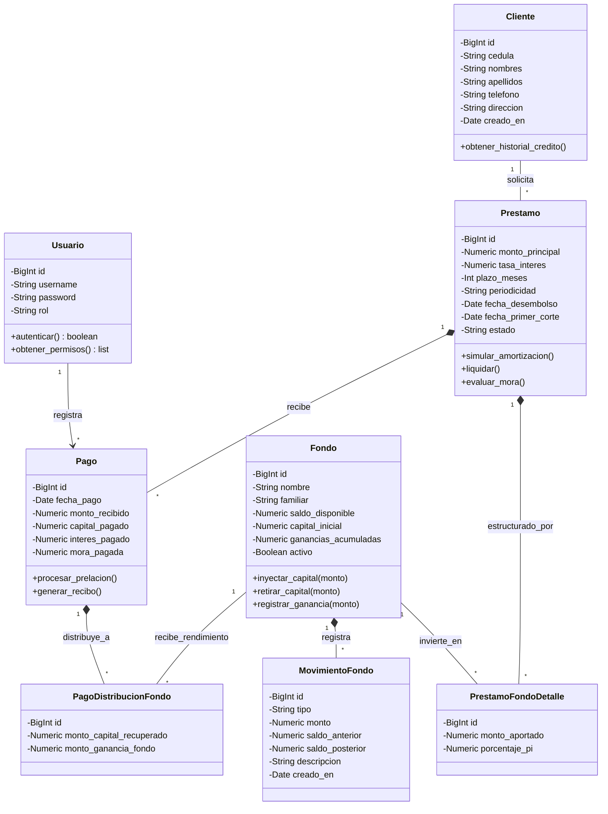
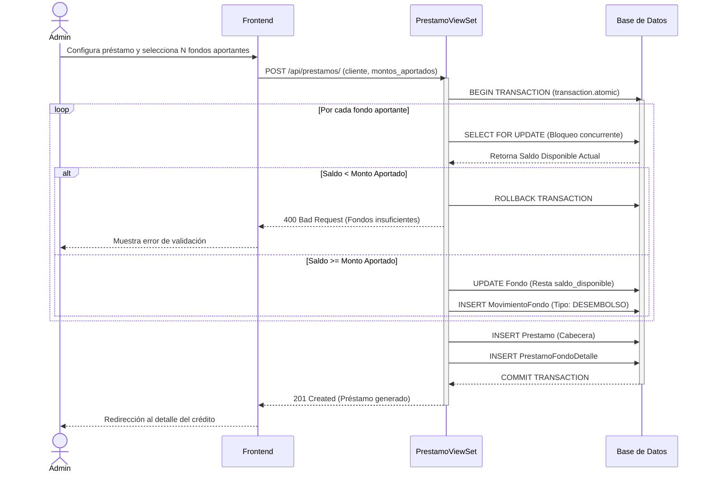
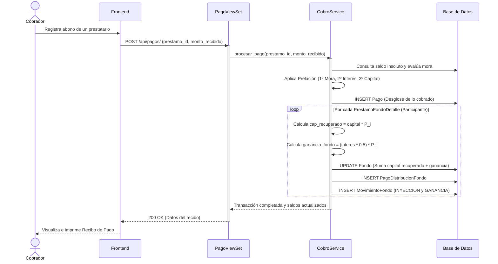
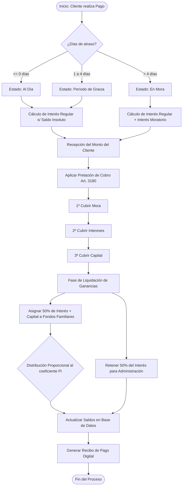

# Sección III: Modelado Estructural en UML

En esta sección se define y formaliza el modelo conceptual e interno del sistema CAVI, identificando las clases de análisis organizadas por estereotipos, las relaciones entre las entidades que conforman la lógica de negocio y un diccionario funcional detallado.

---

## 1. Arquitectura de Clases y Estereotipos

El patrón arquitectónico de CAVI se divide funcionalmente en tres niveles de análisis según el patrón Modelo-Vista-Controlador (MVC / API-Rest). A continuación, se clasifican las clases identificadas:

### A. Clases de Frontera / Interfaz (Boundary)
Manejan la interacción directa con el usuario final (vistas de Preact).
* **UI_Login:** Pantalla de autenticación y acceso.
* **UI_Dashboard:** Panel principal de KPIs, agenda de cobros y métricas globales.
* **UI_Clientes:** Gestión del padrón de prestatarios.
* **UI_Fondos:** Administración de bolsas de inversión, inyecciones y retiros.
* **UI_Prestamos:** Formulario dinámico de desembolsos multifondo y simulador de cuotas.
* **UI_Cobros:** Terminal de asentamiento de pagos y desglose de prelación (mora, interés, capital).

### B. Clases de Control (Control)
Orquestan la lógica de negocio, reglas financieras y transacciones atómicas (ViewSets y Services en Django).
* **AuthService:** Emisión, validación y expiración de tokens JWT.
* **ClienteController:** Validación de cédula única y formato de información del usuario.
* **FondoController:** Validaciones de transacciones de caja, inyecciones, retiros y actualización de saldos disponibles.
* **PrestamoController:** Transacciones atómicas de desembolso, validación de participación ($P_i$) de multifondos y generación de cuotas de amortización.
* **CobroController:** Lógica del motor financiero (Ley 176), prelación de cobros y cálculo de distribución de ganancias 50/50.
* **MoraService:** Job de verificación de 4 días de gracia y semaforización de atrasos.

### C. Clases de Entidad (Entity)
Estructuras persistentes de la base de datos (Modelos de Django) que almacenan la información del sistema.
* **Usuario:** Operadores del sistema (roles: ADMINISTRADOR, COBRANZA).
* **Cliente:** Perfil de prestatarios.
* **Fondo:** Bolsa de inversión familiar.
* **MovimientoFondo:** Registro inmutable del historial financiero de un fondo.
* **Prestamo:** Encabezado del crédito otorgado.
* **PrestamoFondoDetalle:** Tabla pivote con la participación y porcentaje ($P_i$) de los fondos en un préstamo.
* **Pago:** Transacción de abono.
* **PagoDistribucionFondo:** Tabla de liquidación y distribución de retornos y ganancias 50/50.

---

## 2. Diagrama de Clases del Sistema

A continuación se presenta el diagrama de clases en formato UML, definiendo atributos principales, operaciones y sus relaciones de cardinalidad, asociación y agregación.

---

## 3. Diccionario de Clases por Módulos

El presente diccionario desglosa el alcance, visibilidad y naturaleza de datos de las entidades del dominio de negocio.

### Módulo de Usuarios y Clientes
| Clase | Atributos (Visibilidad : Tipo) | Responsabilidad Funcional |
| :--- | :--- | :--- |
| **Usuario** | `- id : BigInt` `- username : String` `- password : String` `- rol : Enum(ADMIN, COBRANZA)` | Gestión de acceso y seguridad RBAC. Define qué acciones puede realizar un operador en caja o configuración. |
| **Cliente** | `- id : BigInt` `- cedula : String` `- nombres : String` `- apellidos : String` `- telefono : String` `- direccion : String` `- creado_en : Date` | Entidad prestataria principal. Almacena la identidad y contacto, vinculándose unívocamente por su número de cédula nicaragüense. |

### Módulo de Gestión de Capitales
| Clase | Atributos (Visibilidad : Tipo) | Responsabilidad Funcional |
| :--- | :--- | :--- |
| **Fondo** | `- id : BigInt` `- nombre : String` `- familiar : String` `- saldo_disponible : Numeric(14,2)` `- capital_inicial : Numeric(14,2)` `- ganancias_acumuladas : Numeric(14,2)` `- activo : Boolean` | Abstracción de una bolsa de inversión. Restringe desembolsos superiores al `saldo_disponible`. Controla la rentabilidad histórica. |
| **MovimientoFondo** | `- id : BigInt` `- tipo : Enum(INYECCION, RETIRO, DESEMBOLSO, GANANCIA)` `- monto : Numeric(14,2)` `- saldo_anterior : Numeric(14,2)` `- saldo_posterior : Numeric(14,2)` `- creado_en : Date` | Historial inmutable de auditoría (Ledger). Asegura rastreabilidad sobre el flujo de efectivo entrante y saliente del Fondo. |

### Módulo de Colocación y Cobranza
| Clase | Atributos (Visibilidad : Tipo) | Responsabilidad Funcional |
| :--- | :--- | :--- |
| **Prestamo** | `- id : BigInt` `- monto_principal : Numeric(14,2)` `- tasa_interes : Numeric(5,4)` `- plazo_meses : Int` `- periodicidad : Enum(MENSUAL, QUINCENAL)` `- estado : Enum(VIGENTE, MORA, LIQUIDADO)` | Contenedor principal de deuda. Aplica Ley 176 para cálculo de interés sobre saldo y delega la partición a detalles. |
| **PrestamoFondoDetalle** | `- monto_aportado : Numeric(14,2)` `- porcentaje_pi : Numeric(5,4)` | Representación matemática fraccionaria del aporte de un Fondo a un Préstamo. `porcentaje_pi` controla las distribuciones futuras. |
| **Pago** | `- monto_recibido : Numeric(14,2)` `- capital_pagado : Numeric(14,2)` `- interes_pagado : Numeric(14,2)` `- mora_pagada : Numeric(14,2)` | Transacción de abono del Cliente. Su controlador aplica la prelación Art. 3180 (mora → interés → capital). |
| **PagoDistribucionFondo** | `- monto_capital_recuperado : Numeric(14,2)` `- monto_ganancia_fondo : Numeric(14,2)` | Representa el "50%" final asignado a la familia. Se calcula como `(interes_pagado * 0.5) * porcentaje_pi`. |

---

## 4. Modelado Dinámico y Comportamental

En esta sección se modela el comportamiento dinámico del sistema para sus flujos más críticos, evidenciando las interacciones entre los componentes y la lógica algorítmica aplicada.

### A. Diagramas de Secuencia
Representación de las llamadas y el intercambio de mensajes en el tiempo para los casos de uso transaccionales clave.

#### Flujo 1: Desembolso Multifondo (Transacción Atómica)
Este diagrama ilustra cómo el sistema asegura el principio ACID cuando un préstamo es fondeado por múltiples bolsas familiares.

#### Flujo 2: Asentamiento de Pago y Liquidación 50/50
Representación de la aplicación de la prelación (Ley 176) y la posterior distribución de dividendos hacia los fondos participantes.

### B. Diagrama de Actividades
Modelado del flujo de trabajo algorítmico y procedimental que rige el motor de cobranza del sistema, desde la evaluación de mora hasta el desembolso de ganancias.

#### Proceso: Evaluación de Mora y Distribución de Cobros

